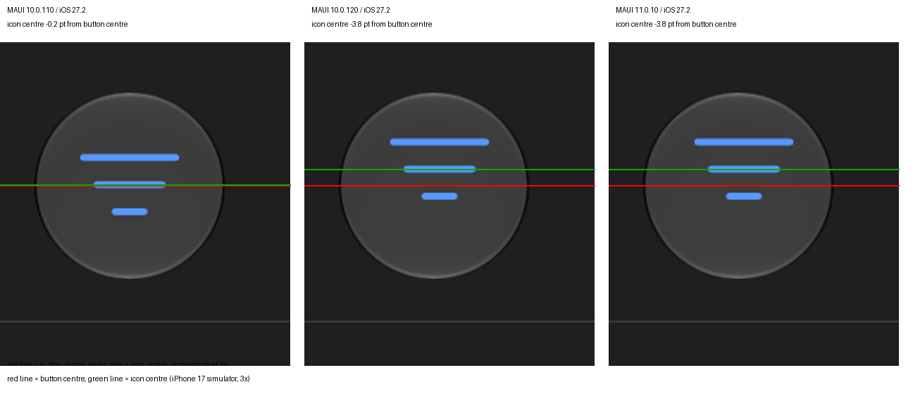

# MauiToolbarIconOffsetRepro

This project is a reproduction for a .NET MAUI regression on iOS 26 and later. MAUI 10.0.120 and later draw a `FontImageSource` toolbar icon above the vertical center of its toolbar button. MAUI 10.0.110 draws the same icon at the center.

The icon is the Fluent System Icons "Filter 28" glyph (`U+F408`), with no `Size` and no `Color`.



| MAUI | Icon center relative to button center (iOS 27.2) |
|---|---|
| 10.0.100, 10.0.101, 10.0.110 | -0.2 pt |
| 10.0.120, 10.0.130, 11.0.10 | -3.8 pt |

The results on the iOS 27.0 simulator are the same as on iOS 27.2.

The first changed version, 10.0.120, is the first version that contains dotnet/maui#39230 ("[iOS] Center FontImageSource glyphs on iOS 26 without changing font metrics"). That change is in `src/Core/src/ImageSources/iOS/ImageSourceExtensions.cs`. It is not in 10.0.110.

## Changes from the template

The project starts from the .NET 11 `maui` template (File > New). These are the changes:

- The project targets iOS only. The XAML files have explicit `xmlns` declarations, so the project also compiles with MAUI 10.
- `MauiProgram` registers `FluentSystemIcons-Regular.ttf` as `FluentRegular`. The font is from [microsoft/fluentui-system-icons](https://github.com/microsoft/fluentui-system-icons) (MIT license).
- `MainPage` has two primary toolbar items with the same `FontImageSource` icon. The left item has `Text`, the right item does not. Both items show the same offset. `Text` has no effect on the result.
- The **Push** button opens a detail page that has one toolbar item. The screenshots and the table use this page.
- `AppShell` sets `Shell.ForegroundColor`.
- A label on the page shows the MAUI version and the iOS version.

## Run the project

Use Xcode 27.2 and an iOS 26 or later simulator.

```
dotnet build -t:Run -f net11.0-ios -p:MauiVersion=11.0.10
```

To build with MAUI 10, use this command:

```
dotnet build -t:Run -f net10.0-ios -p:ReproDotNet=10 -p:MauiVersion=10.0.110
```

Push **Push a page with one titled item**.

- Expected result: the filter icon is at the vertical center of the round toolbar button.
- Actual result (10.0.120 and later): the filter icon is approximately 3.8 pt above the center.

## Screenshots workflow

The `iOS toolbar screenshots` workflow builds the project with MAUI 10.0.100, 10.0.101, 10.0.110, 10.0.120, 10.0.130 and 11.0.10, with Xcode 27.2. It takes screenshots on an iOS 27.0 simulator and on an iOS 27.2 simulator. The `screenshots` folder contains the detail page screenshots for 10.0.110, 10.0.120 and 11.0.10.
